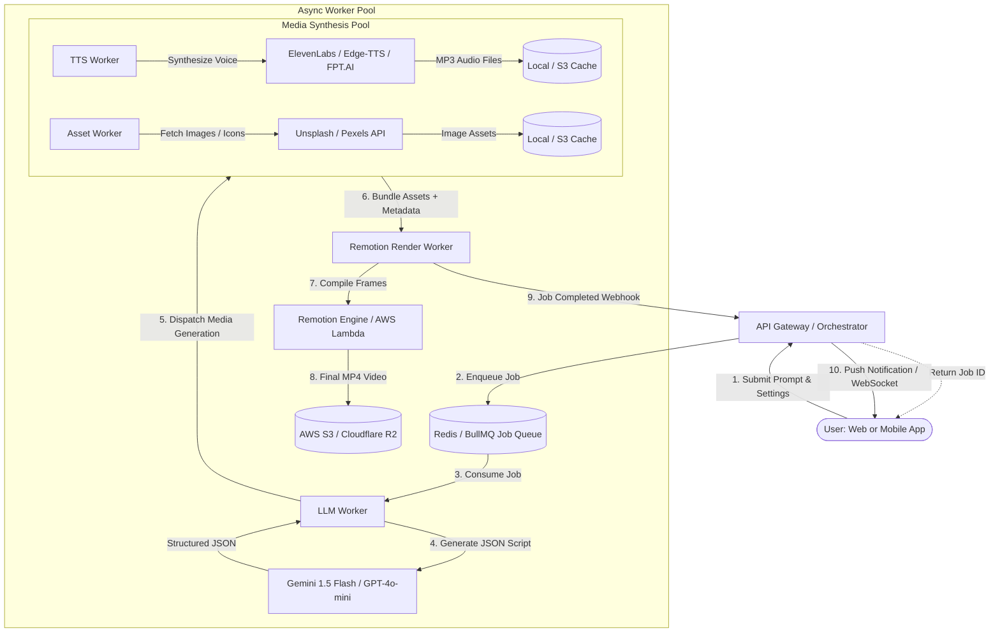

# AIK-VdGeneration: System Architecture & Design

## 1. Executive Summary
AIK-VdGeneration transforms high-level prompts into presentation videos with AI-generated slides and synchronized bilingual voiceovers. The system is architected as an asynchronous, event-driven pipeline separating prompt decomposition, asset synthesis, and video rendering.

---

## 2. Architecture Diagram

---

## 3. Core Subsystems

### 3.1. API Gateway & Orchestrator (`services/api-gateway`)
- **Responsibilities:**
  - Authenticate clients and validate incoming prompt requests.
  - Enqueue video generation tasks onto Redis with priority flags.
  - Expose WebSocket endpoints for streaming progress (0% -> 100%).
  - Deliver signed URLs for completed `.mp4` downloads.

### 3.2. Script Generation Worker (LLM)
- **Responsibilities:**
  - Call Gemini or OpenAI using strict JSON schemas.
  - Break down themes into 3-8 logical slide scenes.
  - Craft natural, spoken-word scripts for the voiceover narrator.
  - Generate search keywords for visual backdrops.

### 3.3. Bilingual Audio Pipeline (TTS)
- **Responsibilities:**
  - Convert per-slide text to audio files (`slide_1.mp3`, `slide_2.mp3`).
  - Read exact duration (using `ffprobe` / `music-metadata`).
  - Normalize volume and format to 44.1kHz / 48kHz stereo MP3.

### 3.4. Video Composition & Render Worker (`services/video-renderer`)
- **Responsibilities:**
  - Consume slide metadata + audio durations.
  - Dynamically compute composition length in frames:
    $$\text{durationInFrames} = \sum_{i=1}^{N} \lceil (\text{audioDuration}_i + \text{padding}) \times \text{FPS} \rceil$$
  - Render React components via Remotion CLI or Remotion Lambda.
  - Encode final video using H.264 / AAC at 1080p, 30fps.

---

## 4. Fault Tolerance & Fallbacks

| Failure Scenario | Recovery Strategy |
| :--- | :--- |
| **Stock image API failure** | Fallback immediately to high-aesthetic CSS gradients or geometric SVG patterns. |
| **Primary TTS API timeout** | Fallback to secondary provider (e.g. ElevenLabs -> Edge-TTS) with logged warning. |
| **Worker node crash** | BullMQ automatically retries the task up to 3 times on another healthy worker instance. |
| **Remotion OOM / Frame timeout** | Remotion Lambda isolates rendering per 50 frames; a single frame retry doesn't ruin the entire render. |
