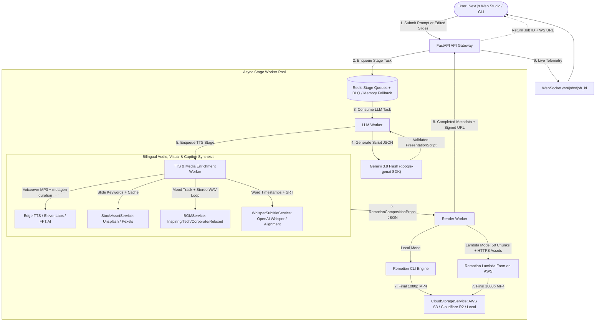

# AIK-VdGeneration: System Architecture & Design

## 1. Executive Summary
AIK-VdGeneration transforms high-level prompts into presentation videos with AI-generated slides, synchronized bilingual (English/Vietnamese) voiceovers, dynamic Ken Burns stock photography, mood-based BGM audio ducking, and word-level karaoke captions. The platform operates as an asynchronous, event-driven pipeline decoupling script generation, media synthesis, and video compilation across independent services.

---

## 2. Architecture Diagram (Phases 1 - 3)

---

## 3. Core Subsystems

### 3.1. API Gateway & Orchestrator (`services/api-gateway`)
- **Responsibilities:**
  - Validates requests against strict Pydantic v2 models aligned with [docs/API_SPEC.md](API_SPEC.md).
  - Enqueues modular tasks (`llm` -> `tts` -> `render`) onto Redis or `LocalMemoryQueueBackend` with automatic 3-attempt retries and Dead-Letter Queue (`aik:queue:dlq`).
  - Streams progress history and real-time events via `/ws/jobs/{job_id}`.
  - Provides interactive Studio endpoints: TikTok channel profile context analysis (`POST /api/v1/channels/tiktok/analyze`), voice audition, BGM mood catalog & audio streaming, Unsplash/Pexels stock search, job artifact streaming (`/audio`, `/assets`, `/subtitles.srt`, `/video`), and S3/R2 SigV4 signed download URL generation (`/video/url`).

### 3.2. Script Generation Worker (`LLMScriptGenerator`) & TikTok Channel Context Service (`TikTokChannelContextService`)
- **Responsibilities:**
  - Uses `google-genai >= 3.2.0` (`client.interactions.create`) targeting `gemini-3.8-flash` (with automatic `gemini-4-hydrogen` fallback) and native JSON Schema Structured Outputs (`response_format`).
  - `TikTokChannelContextService` validates TikTok profile URLs against SSRF, parses public SSR JSON / OpenGraph metadata (reporting verification gates transparently without bypassing CAPTCHAs and accepting optional manual creator notes), and conditions `LLMScriptGenerator` with extracted creator persona, niche, target audience, tone, and content pillars.
  - Decomposes prompts into 3-30 structured slides constrained to 5 layout templates with clean `visual_keywords` for backdrop enrichment.

### 3.3. Media Enrichment Pipeline (`TTSAudioPipeline`, `StockAssetService`, `BGMService`, `WhisperSubtitleService`)
- **Audio-First Duration Sync:** Synthesizes slide MP3s via Edge-TTS or ElevenLabs, validates file size (`> 10KB`) and audio headers, measures exact duration via `mutagen`, and sets `calculated_frames = Math.max(90, Math.ceil((0.2 + durationSec + 0.5) * 30))`.
- **Visual Assets:** Queries Unsplash then Pexels with timeout/retry handling, validates magic headers (JPEG/PNG/WebP >= 1024 bytes), caches locally in `.temp/asset_cache/`, and leaves slides cleanly set to `null` for radial-gradient rendering when unavailable.
- **BGM & Sound Design:** Resolves curated tracks across 4 moods (`inspiring`, `tech`, `corporate`, `relaxed`), generates seamless 44.1kHz stereo WAV loops when local MP3/WAV overrides are not present, and injects `-18 dB` speech ducking / `+3 dB` transition swell metadata.
- **Subtitles:** Extracts word-by-word timestamps via OpenAI Whisper (`whisper-1` with `timestamp_granularities=["word"]`) or monotonic syllable/punctuation-weighted forced alignment fallback, compiling `word_timestamps` and SubRip `.srt` transcripts.

### 3.4. Video Rendering Engine (`services/video-renderer`)
- Consumes compiled `remotion_props.json` strictly without importing Python gateway code (`architecture-rules.md`).
- Renders 5 slide templates (`SlideLayouts.tsx`) with Spring entrance/exit animations, alternating Ken Burns slow pan/zoom + dark scrim (`SlideCard.tsx`), dynamic frame-level BGM envelope modulation (`computeDuckedBgmVolume`), and real-time active word highlighting (`KaraokeCaptions.tsx`).
- Supports stateless single-machine CLI rendering (`RemotionRenderService`) and 50-chunk distributed cloud rendering (`@remotion/lambda@4.0.543` via `scripts/lambda-render.mjs`).

### 3.5. Storage & Delivery (`CloudStorageService`)
- Uploads finished `.mp4` videos and Lambda stage assets via `boto3` (`signature_version="s3v4"`) to AWS S3 or Cloudflare R2 (`R2_ACCOUNT_ID`), mints time-limited presigned URLs (`60s`–`604800s`), and optionally resolves custom `CDN_PUBLIC_BASE_URL` links.

---

## 4. Fault Tolerance & Fallback Matrix

| Failure Scenario | Automatic Recovery Strategy |
| :--- | :--- |
| **Missing Gemini API key / 404 model** | Cascades from `gemini-3.8-flash` to `gemini-4-hydrogen`, then structured local mock generator. |
| **ElevenLabs / primary TTS error** | Automatically degrades to free neural `edge-tts` (`vi-VN-HoaiMyNeural` / `en-US-GuyNeural`). |
| **Unsplash / Pexels API failure or missing key** | Cascades Unsplash -> Pexels -> graceful CSS radial-gradient backdrop without failing the render. |
| **Redis server unreachable** | `QUEUE_MODE=auto` transparently selects `LocalMemoryQueueBackend` + FastAPI background tasks. |
| **Transient worker stage failure** | Worker retries up to `max_retries=3` before persisting structured failure in Dead-Letter Queue. |
| **OpenAI Whisper timeout / missing key** | Falls back deterministically to `align_words_proportionally` calibrated to exact `mutagen` MP3 length. |
| **Remotion Lambda unavailable / failure** | With `REMOTION_LAMBDA_FALLBACK_TO_LOCAL=true`, falls back automatically to local Remotion CLI. |
| **S3 / R2 upload failure or offline mode** | Preserves rendered MP4 on local disk and serves `/api/v1/jobs/{job_id}/video` directly. |
